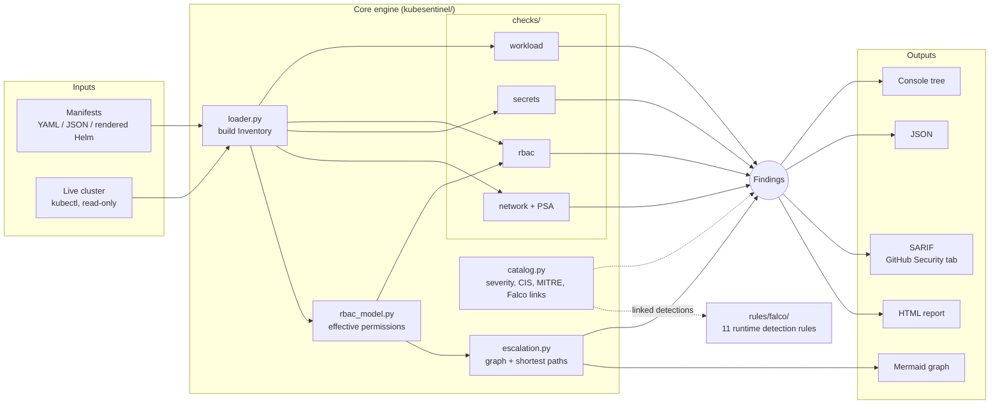

# KubeSentinel

[](https://www.python.org/)
[](LICENSE)
[](https://github.com/LinuxGod-dev/kubesentinel/actions/workflows/ci.yml)

**A Kubernetes security scanner that shows how an attacker could chain RBAC permissions into cluster-admin, and links every finding to the Falco rule that catches its exploitation.**

Flat misconfiguration lists tell you *what is wrong*. KubeSentinel models *who can become whom*, reports the shortest escalation chain to cluster-admin, all Secrets or node compromise, and pairs each finding with a runtime detection.

**Contents:** [Overview](#overview--key-features) · [Architecture](#architecture) · [Repository structure](#repository-structure) · [Install](#prerequisites--installation) · [Quickstart](#quickstart) · [Lab & Falco](#lab--runtime-detection-setup) · [Testing](#testing) · [Roadmap & contributing](#roadmap--contributing) · [License](#license)

---

## Overview & Key Features

Cloud security roles expect container and Kubernetes skills, yet most scanners stop at "this pod is privileged". Real clusters are rarely compromised through one bad setting. They fall to a *chain*: a CI service account that can only create pods, in a namespace that also hosts a cluster-admin service account. KubeSentinel finds those chains, shows the evidence, and tells the defender which Falco alert should fire when someone walks them.

- **RBAC privilege-escalation graph.** Builds a directed graph of subjects and finds the shortest path from every non-system identity to `CLUSTER-ADMIN`, `ALL CLUSTER SECRETS` or `NODE COMPROMISE`. Edges cover workload creation, `pods/exec`, token Secrets, token minting, impersonation, `escalate`/`bind`, and `nodes/proxy`.
- **30 posture checks** across workloads, RBAC, secrets, network policy and Pod Security Admission, each with severity, remediation, CIS reference and MITRE ATT&CK ID (`kubesentinel rules` lists them).
- **Falco integration.** 11 syscall-based runtime rules. Every finding names the rule that detects its exploitation, and the test suite fails if a link breaks.
- **Two input modes.** Scan manifests (CI-friendly, no cluster needed) or a live cluster through read-only `kubectl`. Live mode never reads Secrets.
- **Multi-format reporting.** Rich console output, JSON, SARIF 2.1.0 for GitHub code scanning, a self-contained HTML report, and a Mermaid graph of the escalation paths.
- **CI gate.** `--fail-on <severity>` returns a non-zero exit code to block a build.
- **Safe by design.** Matched secret values are always masked in output.
- **Reproducible lab.** A deliberately vulnerable namespace set, a hardened baseline and an attack manifest on a `kind` cluster, so you can demonstrate offense → finding → alert end to end.

| Area | Rule IDs | Examples |
|---|---|---|
| Workloads | `KS-WL-001…011` | privileged, host namespaces, `hostPath` and runtime sockets, dangerous capabilities, root, writable rootfs, unpinned images |
| RBAC | `KS-RBAC-001…010` | cluster-admin grants, wildcards, `escalate`/`bind`/`impersonate`, secrets read, `pods/exec`, `nodes/proxy`, default-SA bindings |
| Secrets | `KS-SEC-001…003` | literal credentials in env vars, credentials in ConfigMaps, Secret objects in manifests |
| Network / admission | `KS-NET-001…002`, `KS-ADM-001` | no NetworkPolicy, no default-deny, Pod Security not enforced |
| Escalation paths | `KS-ESC-001…003` | shortest chain to cluster-admin / all Secrets / node compromise |

---

## Architecture



**Workflow:** inputs are loaded into one `Inventory`; the check modules and the RBAC model run over it; the escalation engine searches the permission graph with breadth-first search; everything lands in a single list of `Finding` objects that the reporters render. `catalog.py` is the single source of truth for severity, remediation and the link from each finding to a Falco rule.

---

## Repository Structure

```
kubesentinel/
├── kubesentinel/                  # core Python package
│   ├── cli.py                     #   argparse CLI: `scan`, `rules`
│   ├── loader.py                  #   manifests / live kubectl -> Inventory
│   ├── models.py                  #   Finding, Severity
│   ├── catalog.py                 #   rule metadata, CIS/MITRE, Falco links
│   ├── rbac_model.py              #   effective-permission model
│   ├── escalation.py              #   permission graph + shortest-path search
│   ├── scanner.py                 #   orchestrates all checks
│   ├── report.py                  #   console, JSON, SARIF, HTML
│   └── checks/                    #   workload.py · rbac.py · secrets.py · network.py
├── labs/
│   ├── kind-config.yaml           #   2-node kind cluster
│   ├── vulnerable/                #   deliberately insecure namespaces, RBAC, workloads
│   ├── baseline/                  #   hardened reference (should scan clean)
│   └── attacks/steal-tiller.yaml  #   proves the ci-runner -> tiller -> cluster-admin path
├── rules/falco/
│   └── kubesentinel_rules.yaml    # 11 runtime detection rules
├── tests/                         # pytest suite
├── .github/workflows/ci.yml       # tests, SARIF upload, Falco rule validation
├── reports/                       # generated output (git-ignored)
├── pyproject.toml · requirements.txt · LICENSE
```

---

## Prerequisites & Installation

| Tool | Version | Needed for |
|---|---|---|
| Python | 3.9+ (developed on 3.12) | the scanner |
| Docker | Desktop or Engine, **8 GiB RAM** for the 2-node lab (less for 1 node) | lab cluster |
| kind | current | lab cluster |
| kubectl | current | live scans and the lab |
| Helm | 3.x | installing Falco |

Only Python is needed to scan manifests. The other tools are for the [lab](#lab--runtime-detection-setup).

```bash
git clone https://github.com/LinuxGod-dev/kubesentinel.git
cd kubesentinel
```

Create a virtual environment and install:

```bash
# Linux / macOS / WSL
python3 -m venv .venv && source .venv/bin/activate
pip install -e ".[dev]"
```
```powershell
# Windows PowerShell
py -m venv .venv
.\.venv\Scripts\Activate.ps1      # if blocked: Set-ExecutionPolicy -Scope Process -ExecutionPolicy Bypass
pip install -e ".[dev]"
```

`pip install -r requirements.txt` also works if you only want the dependencies. Verify:

```bash
kubesentinel --version        # kubesentinel 0.1.0   (fallback: python -m kubesentinel --version)
```

Windows with kind/Falco: install the tools with `winget install Kubernetes.kind Kubernetes.kubectl Helm.Helm`.

---

## Quickstart

The fastest way to see it work, with no cluster:

```bash
kubesentinel scan labs/vulnerable
```

On the lab this reports 10 CRITICAL, 16 HIGH, 12 MEDIUM and 11 LOW findings, then the escalation paths. Abridged:

```
RBAC escalation paths (shortest chain per source and target)
→ CLUSTER-ADMIN  (5 source(s))
├── ServiceAccount dev/ci-runner  2 hop(s)
│   ├── ServiceAccount dev/ci-runner ── create a workload in 'dev' that runs as dev/tiller (RoleBinding dev/ci-runner-deployer -> Role ci-deployer) ──▶ ServiceAccount dev/tiller
│   └── ServiceAccount dev/tiller ── already holds cluster-admin-equivalent rights (ClusterRoleBinding tiller-admin -> ClusterRole cluster-admin) ──▶ CLUSTER-ADMIN
```

A service account that can *only create pods in one namespace* reaches cluster-admin in two hops. The hardened baseline scans clean: `kubesentinel scan labs/baseline`.

### Common commands

| Command | What it does |
|---|---|
| `kubesentinel scan PATH...` | scan manifest files or directories (YAML/JSON) |
| `kubesentinel scan --live` | scan the current `kubectl` context (read-only) |
| `kubesentinel rules` | list every check with MITRE IDs and linked Falco rules |

| Flag | Purpose |
|---|---|
| `--context NAME` | kubectl context to use with `--live` |
| `--exclude-namespace NS` | skip a namespace (repeatable), e.g. `kube-system` |
| `--include-system` | treat `system:*` and `kube-system` identities as path sources |
| `--min-severity LEVEL` | hide findings below `info`/`low`/`medium`/`high`/`critical` |
| `-v`, `--verbose` | show messages, evidence, remediation and linked detections |
| `--fail-on LEVEL` | exit `1` if any finding is at or above `LEVEL` (CI gate) |
| `--json FILE` · `--sarif FILE` · `--html FILE` · `--mermaid FILE` | write reports |
| `--quiet` | no console output |

```bash
# Evidence, remediation and the Falco rule for each high+ finding
kubesentinel scan labs/vulnerable --verbose --min-severity high

# All report formats at once
kubesentinel scan labs/vulnerable --html reports/report.html --json reports/report.json \
  --sarif reports/report.sarif --mermaid reports/paths.mmd

# CI: render Helm, fail the build on HIGH or worse, publish to GitHub's Security tab
helm template ./chart > rendered.yaml
kubesentinel scan rendered.yaml --fail-on high --sarif kubesentinel.sarif
```

Paste `reports/paths.mmd` into <https://mermaid.live> to see the escalation graph. Helm and Kustomize templates cannot be parsed directly; render them first (`helm template`, `kubectl kustomize`). Files that fail to parse are reported as warnings, never dropped silently.

---

## Lab / Runtime Detection Setup

> The lab manifests are **intentionally insecure** and contain fake credentials. Run them only in a throw-away cluster.

### 1. Create the cluster

```bash
kind create cluster --config labs/kind-config.yaml     # 2 nodes
kubectl get nodes                                       # expect 2 x Ready
```

**If it fails** with `could not find a log line that matches "Reached target ..."`, the node ran out of resources (common on Docker Desktop/WSL2 with under ~6 GiB). Check `docker info | grep -E "Cgroup Version|CPUs|Total Memory"`, raise memory (Windows: set `memory=8GB` in `%UserProfile%\.wslconfig`, then `wsl --shutdown` and restart Docker Desktop), or use a single node, which still runs every lab step:

```bash
kind delete cluster --name kubesentinel
kind create cluster --name kubesentinel
```

If the node log mentions `inotify`, run `wsl -d docker-desktop sysctl -w fs.inotify.max_user_watches=524288 fs.inotify.max_user_instances=512` (resets on restart). Get the log with `kind create cluster --name kubesentinel --retain` then `docker logs kubesentinel-control-plane --tail 60`.

### 2. Deploy the vulnerable lab and scan the live cluster

```bash
kubectl apply -f labs/vulnerable/
kubectl get pods -A                                     # attacker-pod, payments-api, backup-agent -> Running
kubesentinel scan --live --exclude-namespace kube-system --min-severity high
```

### 3. Prove the headline finding

`ci-runner` can only create pods in `dev`, yet the scanner says it reaches cluster-admin. Verify, then exploit:

```bash
kubectl auth can-i create pods -n dev --as=system:serviceaccount:dev:ci-runner      # yes
kubectl auth can-i "*" "*"           --as=system:serviceaccount:dev:ci-runner      # no
kubectl create -f labs/attacks/steal-tiller.yaml --as=system:serviceaccount:dev:ci-runner
kubectl logs -n dev steal-tiller          # "ACCESS GRANTED" + the start of a SecretList from kube-system
```

Fix and re-scan: `kubectl label namespace dev pod-security.kubernetes.io/enforce=baseline --overwrite` removes the node-compromise paths through `dev`. The tiller chain remains, because Pod Security does not fix RBAC. Remove the cluster-admin binding for that.

### 4. Install Falco with the KubeSentinel rules

> Falco needs kernel access: it is most reliable on a native Linux host or VM. On Docker Desktop/WSL2 it may work with the modern eBPF driver; if the pod crash-loops, read its logs for a driver error.

Validate the rules, then install:

```bash
docker run --rm -v "$PWD/rules/falco:/rules:ro" falcosecurity/falco-no-driver:latest \
  falco --validate /rules/kubesentinel_rules.yaml

helm repo add falcosecurity https://falcosecurity.github.io/charts && helm repo update
helm install falco falcosecurity/falco -n falco --create-namespace \
  --set driver.kind=modern_ebpf --set tty=true \
  --set-file "customRules.kubesentinel\.yaml=rules/falco/kubesentinel_rules.yaml"
kubectl get pods -n falco                               # expect Running
```

(PowerShell: use `${PWD}` in the `-v` path and put the `helm install` command on one line. If the chart rejects a value, check its `values.yaml` for the current `driver` and `customRules` key names.)

### 5. Trigger the detections

In a second terminal, watch alerts: `kubectl logs -n falco -l app.kubernetes.io/name=falco -c falco -f`. Then run these one at a time:

| # | Command | Expected alert |
|---|---|---|
| 1 | `kubectl exec -it -n dev attacker-pod -- sh` | Interactive Shell in Container |
| 2 | `kubectl exec -n dev attacker-pod -- cat /var/run/secrets/kubernetes.io/serviceaccount/token` | ServiceAccount Token Read by Suspicious Process |
| 3 | `kubectl exec -n dev attacker-pod -- apk add --no-cache curl` | Package Manager Run in Container |
| 4 | `kubectl exec -n dev attacker-pod -- sh -c "echo --donate-level 1 stratum+tcp://pool.invalid:3333"` | Crypto Miner Activity in Container |
| 5 | `kubectl exec -n dev attacker-pod -- nsenter -t 1 -m -u -i -n -p -- hostname` | Container Escape via nsenter |
| 6 | `kubectl exec -n dev attacker-pod -- mount -t tmpfs none /mnt` | Mount Syscall in Container |
| 7 | `kubectl exec -n dev attacker-pod -- wget -qO- --no-check-certificate https://kubernetes.default.svc/version` | Kubernetes API Client in Container |
| 8 | `kubectl exec -n dev attacker-pod -- cat /etc/shadow` | Sensitive Credential File Read in Container |
| 9 | `kubectl exec -n dev attacker-pod -- sh -c "echo test >> /etc/ks-test"` | Write to Sensitive Directory in Container |

Row 5 needs `nsenter` in the image (if missing: `kubectl exec -n dev attacker-pod -- apk add --no-cache util-linux`). The `steal-tiller` pod from step 3 also fires rows 2 and 7. The runtime-socket and reverse-shell rules are not simulated. Tune the allow-lists at the top of `rules/falco/kubesentinel_rules.yaml` to cut false positives in your environment.

### 6. Clean up

```bash
kind delete cluster --name kubesentinel
```

---

## Testing

```bash
pytest -q
```

Expected: `53 passed`. The suite covers:

- every check family, including positive and negative cases (benign `hostPath`, `valueFrom` secrets, placeholders, `resourceNames`)
- escalation paths on the lab: the 2-hop and 3-hop chains, direct RBAC self-escalation, Pod Security removing node paths, admin identities treated as sinks
- live mode against a fake `kubectl`: it is read-only, never requests Secrets, and skips controller-owned pods
- the Falco rule file: schema, unique names, every `ks_` macro/list defined, every finding linked to an existing rule, every rule linked from a finding
- reports and CLI: JSON, SARIF and HTML output, the `--fail-on` gate, and a check that secret values never appear in any report

The CI workflow (`.github/workflows/ci.yml`) runs the tests on Python 3.9, 3.11 and 3.12, uploads SARIF for the lab scan to the Security tab, and validates the Falco rules.

---

## Roadmap & Contributing

**Roadmap**

- [ ] Kubernetes audit-log Falco rules (e.g. privileged pod created)
- [ ] Kyverno / Gatekeeper-aware admission checks
- [ ] Attack-path graph embedded in the HTML report
- [ ] Helm chart for scheduled in-cluster scans
- [ ] MITRE ATT&CK for Containers coverage matrix

**Known limitations** (read before trusting a result)

- `apiGroups` are ignored when matching RBAC resources, which can over-report.
- Built-in ClusterRoles (`admin`, `edit`, `view`) are approximated when scanning manifests; live mode reads the real aggregated rules.
- "Read Secrets → use token" edges only apply where long-lived token Secrets exist; modern clusters do not create them by default. The path text says so.
- Rules restricted by `resourceNames` are ignored for capability checks, except impersonation.
- Pod Security is read from namespace labels only, so Kyverno/Gatekeeper users may see false `KS-ADM-001` findings.
- CIS references follow benchmark v1.8 numbering and are approximate.
- KubeSentinel is narrow on purpose. For broad compliance coverage use Trivy, kube-bench or Kubescape alongside it.

**Contributing**

Issues and pull requests are welcome. For bugs, open an issue with the command you ran, the manifests (with secrets removed) and the output. For a new check:

1. Add a `Rule` to `kubesentinel/catalog.py` (severity, remediation, MITRE ID, linked Falco rule names).
2. Implement it in the matching module under `kubesentinel/checks/` using `make_finding("KS-...", ...)`.
3. Add tests, including a negative case, and run `pytest -q`. The Falco cross-link tests will fail if a link points at a missing rule.
4. Never commit real credentials. Lab fixtures must use obviously fake values.

---

## License

Released under the MIT License. See [LICENSE](LICENSE).
